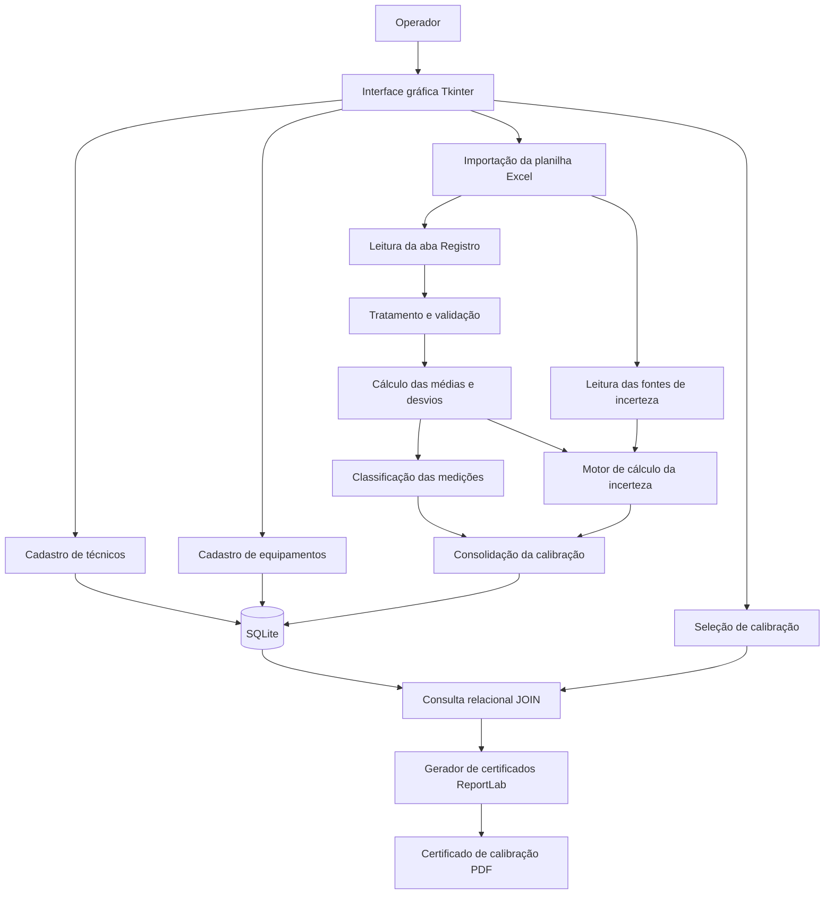
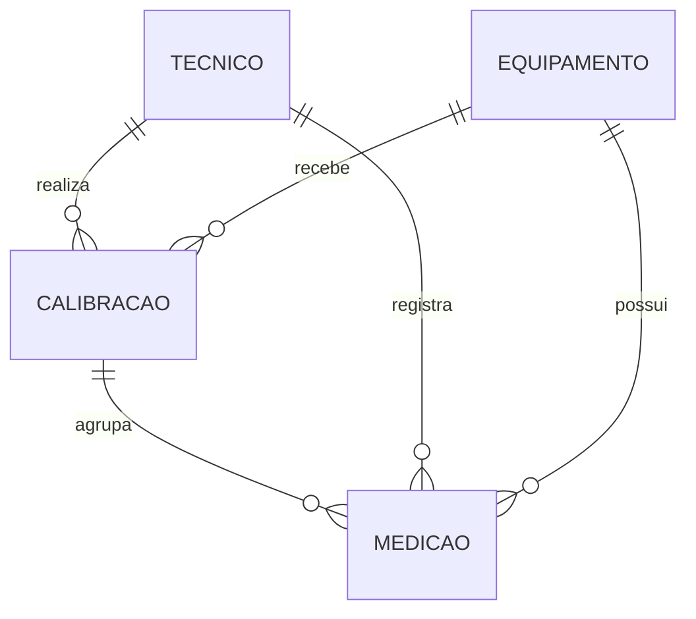
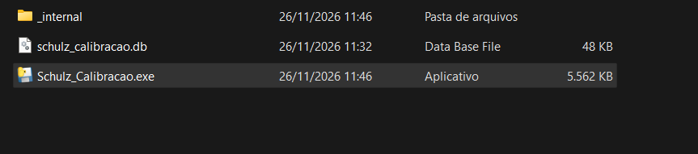
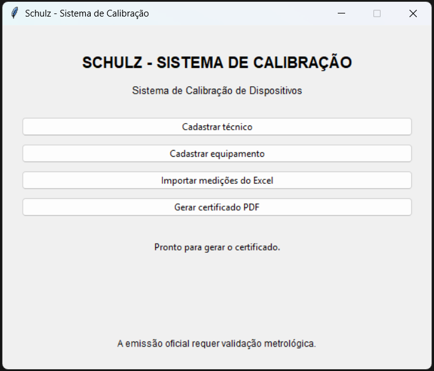
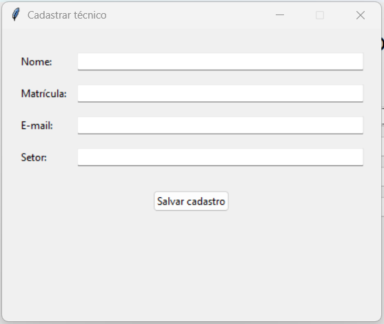
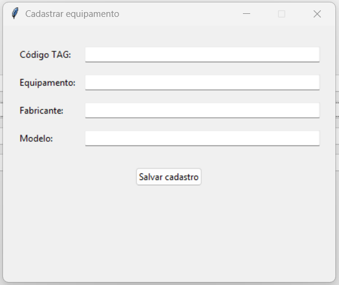
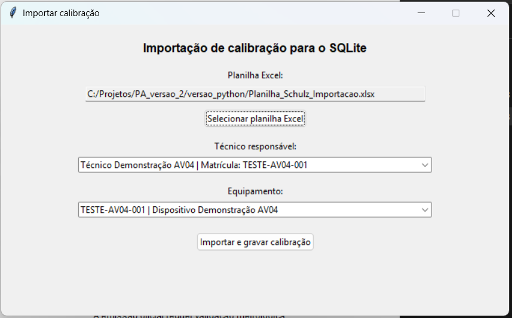
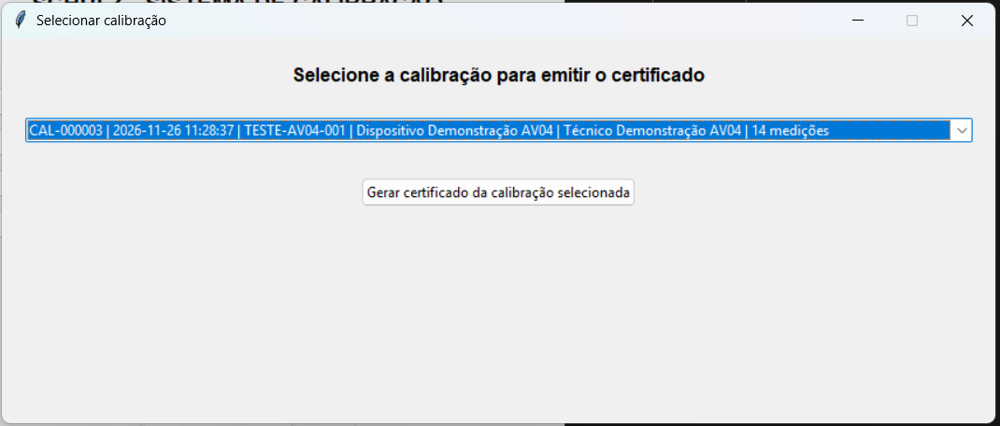
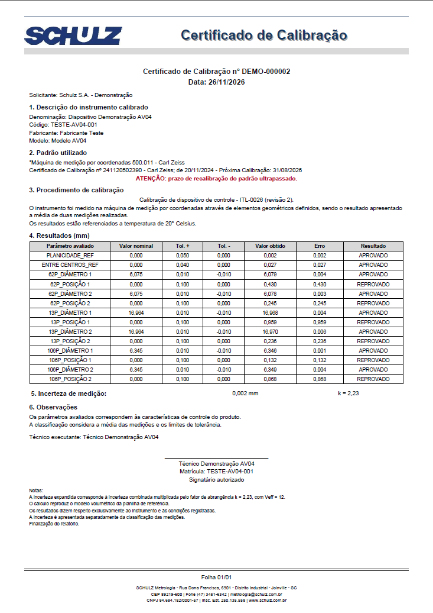

<style>
@page {
    size: A4 portrait;
    margin: 18mm;
}

@media print {
    body, .markdown-preview {
        font-family: Arial, sans-serif !important;
        font-size: 10.5pt !important;
        line-height: 1.4 !important;
    }

    h1, h2, h3, h4 {
        break-after: avoid;
        page-break-after: avoid;
    }

    p {
        orphans: 3;
        widows: 3;
    }

    img {
        display: block;
        max-width: 100% !important;
        max-height: 190mm !important;
        width: auto;
        height: auto;
        margin: 8px auto;
        object-fit: contain;
        break-inside: avoid;
        page-break-inside: avoid;
    }

    .mermaid {
        break-inside: avoid;
        page-break-inside: avoid;
    }

    .mermaid svg {
        max-width: 100% !important;
        max-height: 190mm !important;
        height: auto !important;
    }

    table {
        width: 100%;
        font-size: 9.5pt;
        border-collapse: collapse;
    }

    tr {
        break-inside: avoid;
        page-break-inside: avoid;
    }

    thead {
        display: table-header-group;
    }

    pre, pre code {
        white-space: pre-wrap !important;
        overflow-wrap: anywhere !important;
        word-break: break-word;
        font-size: 8.5pt !important;
    }

    pre {
        break-inside: avoid;
        page-break-inside: avoid;
    }

    p:has(+ p > img) {
        break-after: avoid;
        page-break-after: avoid;
    }

    p:has(> img) {
        break-inside: avoid;
        page-break-inside: avoid;
    }
}
</style>

# AV04 — Documentação Final do MVP e Manual do Usuário

## Sistema de Calibração de Dispositivos

**Unidade Curricular:** Projeto Aplicado I  
**Empresa parceira:** Schulz S.A.  
**Docentes:** Prof. MSc. Hugo Menezes Barra e Prof. Rodrigo Losina  
**Alunos:** Bruno Henridson Galvão, Lucas Jean Pacheco, Mateus Junior Consoli, Rodrigo Nunes, Sthefane Pita  
**Entrega:** AV04 — Finalização da Construção do MVP e Geração do Executável  
**Ano:** 2026  

---

## 1. Introdução

O presente documento apresenta a documentação técnica e operacional do Produto Mínimo Viável (MVP) desenvolvido para a Schulz S.A., no contexto da Unidade Curricular Projeto Aplicado I.

O projeto tem como finalidade automatizar etapas do processo de calibração de dispositivos, integrando a importação de planilhas eletrônicas, o tratamento das medições, o cálculo da incerteza de medição, o armazenamento das informações em banco de dados relacional e a geração de certificados de calibração em formato PDF.

A quarta etapa do projeto consolida as funcionalidades desenvolvidas nas avaliações anteriores em uma aplicação integrada, disponibilizada por meio de um executável para Windows, eliminando a necessidade de utilização de terminal ou ambiente de desenvolvimento pelo operador.

### 1.1 Evolução do projeto

| Etapa | Desenvolvimento |
|---|---|
| AV01 | Levantamento de requisitos e regras de tratamento dos dados. |
| AV02 | Modelagem e implementação do banco de dados SQLite. |
| AV03 | Desenvolvimento das classes, persistência e validação das medições. |
| AV04 | Integração das funcionalidades, interface gráfica, cálculo da incerteza, emissão de certificados e geração do executável. |

## 2. Objetivos

### 2.1 Objetivo geral

Desenvolver uma aplicação integrada para automatizar o processamento das informações relacionadas à calibração de dispositivos da Schulz S.A.

### 2.2 Objetivos específicos

- Disponibilizar uma interface gráfica de operação.
- Cadastrar técnicos e equipamentos.
- Importar medições provenientes de planilhas Excel.
- Tratar e validar os dados importados.
- Calcular as médias e os desvios padrão das medições.
- Classificar os resultados conforme os limites de tolerância.
- Calcular a incerteza expandida de medição.
- Armazenar as informações em banco de dados SQLite.
- Recuperar informações por meio de consultas relacionais.
- Gerar certificados de calibração em PDF.
- Disponibilizar a aplicação em formato executável para Windows.

## 3. Tecnologias utilizadas

| Tecnologia | Versão ou identificação | Finalidade |
|---|---|---|
| Python | 3.13.17 | Desenvolvimento da aplicação. |
| SQLite | Biblioteca padrão do Python | Persistência relacional dos dados. |
| Tkinter | Biblioteca padrão do Python | Interface gráfica. |
| OpenPyXL | 3.1.5 | Leitura das planilhas Excel. |
| ReportLab | 5.1.0 | Geração dos certificados PDF. |
| PyInstaller | 6.22.3 | Empacotamento do executável. |
| Visual Studio Code | Ambiente de desenvolvimento | Implementação e manutenção do código. |
| GitHub | Repositório remoto | Versionamento e documentação. |
| Markdown | Formato textual | Documentação técnica do projeto. |

## 4. Arquitetura final integrada

A aplicação foi desenvolvida utilizando Programação Orientada a Objetos e organização modular, separando as responsabilidades relacionadas à interface gráfica, às entidades do sistema, ao banco de dados e aos serviços de processamento.

Essa organização facilita a manutenção, a identificação de responsabilidades e a evolução futura da aplicação.

### 4.1 Diagrama de fluxo ponta a ponta



### 4.2 Estrutura do projeto

```text
versao_python/
├── assets/
│   └── schulz_logo_original.jpg
├── classes/
│   ├── __init__.py
│   ├── banco_dados.py
│   ├── equipamento.py
│   ├── medicao.py
│   └── tecnico.py
├── servicos/
│   ├── __init__.py
│   ├── calculo_incerteza.py
│   ├── classificador_medicoes.py
│   ├── gerador_certificado.py
│   ├── importador_registro.py
│   ├── incerteza_certificado.py
│   ├── integracao_certificado_sqlite.py
│   └── motor_incerteza.py
├── dist/
│   └── Schulz_Calibracao/
│       ├── _internal/
│       ├── Schulz_Calibracao.exe
│       └── schulz_calibracao.db
├── .gitignore
├── 01_estrutura.md
├── 02_dicionario.md
├── 03_banco.sql
├── 04_classes.py
├── 05_main.py
├── 06_migracao_banco_av04.py
├── 06_mvp_parte1.md
├── 07_gerador_certificado.py
├── 08_mvp_final_manual.md
├── executar_banco.py
├── Planilha_Schulz_Importacao.xlsx
├── requirements.txt
├── schulz_calibracao.db
└── Schulz_Calibracao.spec
```

A estrutura apresentada contempla os principais arquivos necessários ao desenvolvimento e à distribuição, omitindo arquivos temporários, ambientes virtuais e caches.

### 4.3 Responsabilidades dos módulos

| Módulo | Responsabilidade |
|---|---|
| 07_gerador_certificado.py | Interface gráfica e integração das funcionalidades. |
| banco_dados.py | Conexão e persistência no SQLite. |
| tecnico.py | Representação dos técnicos. |
| equipamento.py | Representação dos equipamentos. |
| medicao.py | Representação e processamento das medições. |
| importador_registro.py | Extração das medições da planilha. |
| classificador_medicoes.py | Classificação conforme os limites de tolerância. |
| calculo_incerteza.py | Funções matemáticas relacionadas à incerteza. |
| motor_incerteza.py | Consolidação dos cálculos de incerteza. |
| incerteza_certificado.py | Extração das fontes de incerteza e informações complementares. |
| integracao_certificado_sqlite.py | Recuperação dos dados consolidados no SQLite. |
| gerador_certificado.py | Construção do certificado PDF. |
| 06_migracao_banco_av04.py | Ampliação da estrutura do banco para a AV04. |

## 5. Banco de dados relacional

O SQLite foi utilizado como mecanismo de persistência devido à sua simplicidade, integração com Python e ausência de necessidade de instalação de um servidor de banco de dados.

### 5.1 Entidades

| Entidade | Finalidade |
|---|---|
| tecnico | Armazenar os dados dos técnicos responsáveis. |
| equipamento | Armazenar a identificação dos dispositivos. |
| calibracao | Consolidar os dados de cada calibração e seus cálculos de incerteza. |
| medicao | Armazenar os parâmetros avaliados e seus respectivos resultados. |

### 5.2 Relacionamentos



### 5.3 Evolução da estrutura

Durante a AV04, foi incorporada a entidade calibracao, permitindo agrupar as medições pertencentes a um mesmo procedimento.

Também foram adicionados campos destinados ao armazenamento das duas leituras, do desvio padrão e do vínculo entre cada medição e sua respectiva calibração.

A estrutura original desenvolvida nas avaliações anteriores foi preservada, sendo ampliada por meio de um script de migração.

### 5.4 Integridade dos dados

A aplicação utiliza:

- Chaves primárias.
- Chaves estrangeiras.
- Consultas SQL parametrizadas.
- Transações para gravação das calibrações.
- Confirmação das operações por commit.
- Reversão das operações em caso de falha.
- Verificação da integridade referencial.

Ao término dos testes, os registros fictícios foram removidos dos bancos ativos, mantendo-se a estrutura necessária para novos cadastros.

Os bancos utilizados durante a validação foram preservados separadamente como evidências do desenvolvimento.

## 6. Módulo de ingestão e saneamento — ETL

O processo de ingestão foi implementado utilizando a biblioteca OpenPyXL.

A planilha de referência é utilizada como fonte das informações necessárias ao processamento, sem que o arquivo original seja modificado pela aplicação.

### 6.1 Extração

A principal fonte das medições é a aba Registro.

São recuperadas informações relacionadas a:

- Identificação do parâmetro avaliado.
- Valor nominal.
- Tolerância positiva.
- Tolerância negativa.
- Primeira medição.
- Segunda medição.
- Média registrada na planilha.
- Desvio padrão registrado na planilha.

As informações complementares relacionadas à incerteza, aos padrões utilizados e ao procedimento de calibração são recuperadas das respectivas abas da planilha.

### 6.2 Transformação

O processamento contempla a seleção dos registros preenchidos, a validação das informações necessárias, a verificação dos valores numéricos e o cálculo das métricas utilizadas pela aplicação.

As linhas sem medições válidas não devem constituir registros de calibração.

Os valores necessários aos cálculos são submetidos à verificação de consistência numérica, incluindo a identificação de valores não finitos.

A higienização é direcionada à estrutura da planilha de referência utilizada no projeto. A cobertura de todas as possíveis variações de nomenclaturas e caracteres inválidos previstas na AV01 ainda requer validação complementar.

### 6.3 Cálculo da média

Para cada parâmetro avaliado, a média aritmética é calculada considerando as duas leituras:

$$
\bar{x} = \frac{x_1+x_2}{2}
$$

Onde:

- x1 corresponde à primeira medição.
- x2 corresponde à segunda medição.
- x̄ corresponde à média obtida.

### 6.4 Cálculo do desvio padrão

O desvio padrão amostral é calculado por:

$$
s = \sqrt{\frac{\sum_{i=1}^{n}(x_i-\bar{x})^2}{n-1}}
$$

A dispersão obtida é utilizada como uma das entradas do modelo de cálculo da incerteza.

### 6.5 Carregamento

Após o processamento, os registros são armazenados no SQLite e vinculados ao técnico, ao equipamento e à calibração correspondente.

A gravação é realizada de forma transacional, evitando a persistência parcial de uma calibração em caso de falha durante a operação.

## 7. Classificação dos resultados

A classificação das medições considera os limites de tolerância definidos para cada parâmetro.

O limite inferior é calculado por:

$$
L_{inf} = V_n + T_{neg}
$$

O limite superior é calculado por:

$$
L_{sup} = V_n + T_{pos}
$$

Onde:

- Vn representa o valor nominal.
- Tneg representa a tolerância negativa com seu respectivo sinal.
- Tpos representa a tolerância positiva.

A medição é classificada como APROVADO quando:

$$
L_{inf} \leq \bar{x} \leq L_{sup}
$$

Caso a média obtida esteja fora desse intervalo, a medição é classificada como REPROVADO.

Os valores coincidentes com os limites são considerados aprovados.

A regra implementada considera a média das medições em relação às tolerâncias, sem aplicação de uma faixa de guarda baseada na incerteza expandida.

## 8. Motor de cálculo da incerteza

O modelo de incerteza implementado na versão final do MVP reproduz o modelo volumétrico utilizado na planilha de referência.

### 8.1 Componentes considerados

O modelo contempla oito componentes de incerteza:

1. Dispersão das medições.
2. Incerteza volumétrica da máquina de medir por coordenadas.
3. Incerteza da esfera padrão.
4. Influência do sistema de apalpação.
5. Resolução.
6. Erro sistemático.
7. Influência da temperatura de referência.
8. Diferença de temperatura entre padrão e objeto.

Os valores das fontes complementares são recuperados da planilha de referência.

### 8.2 Incerteza padrão

A contribuição de cada componente é determinada considerando o valor da fonte, seu divisor e o coeficiente de sensibilidade correspondente.

$$
u_i = \frac{a_i}{d_i}
$$

$$
g_i = c_i \cdot u_i
$$

### 8.3 Incerteza combinada

A incerteza combinada é determinada pela raiz quadrada da soma dos quadrados das contribuições:

$$
u_c = \sqrt{\sum_{i=1}^{m}g_i^2}
$$

### 8.4 Graus de liberdade efetivos

Os graus de liberdade efetivos são determinados pela equação de Welch-Satterthwaite:

$$
\nu_{eff} =
\frac{u_c^4}
{\sum_{i=1}^{m}\frac{g_i^4}{\nu_i}}
$$

O tratamento da parte inteira dos graus de liberdade segue o comportamento adotado no modelo da planilha de referência.

### 8.5 Fator de abrangência

O fator de abrangência k é selecionado conforme os graus de liberdade efetivos, reproduzindo a regra de seleção utilizada na planilha.

### 8.6 Incerteza expandida

A incerteza expandida é calculada por:

$$
U = k \cdot u_c
$$

A aplicação realiza a conversão necessária para apresentação do resultado no certificado, seguindo o modelo de referência adotado.

### 8.7 Resultado da validação

| Indicador | Resultado obtido |
|---|---:|
| Componentes de incerteza | 8 |
| Maior desvio padrão original | 0,000707106781 |
| Dispersão convertida | 0,707106781 µm |
| Incerteza da dispersão | 0,500000000 µm |
| Incerteza combinada | 0,931344277 µm |
| Graus de liberdade efetivos calculados | 12,013557 |
| Graus de liberdade utilizados | 12 |
| Fator de abrangência | 2,23 |
| Incerteza expandida | 2,076897738 µm |
| Incerteza convertida | 0,002076898 mm |
| Incerteza apresentada no certificado | 0,002 mm |

Os resultados obtidos reproduziram os valores do modelo volumétrico utilizado como referência durante a validação do MVP.

## 9. Motor de emissão de certificados

A emissão dos certificados foi implementada utilizando a biblioteca ReportLab.

O certificado é gerado a partir das informações armazenadas no SQLite, não sendo necessária uma nova seleção da planilha Excel.

### 9.1 Recuperação relacional

A aplicação utiliza consultas relacionais JOIN para recuperar:

- Dados do técnico responsável.
- Dados do equipamento.
- Identificação da calibração.
- Resultados das medições.
- Informações da incerteza.
- Padrões utilizados.
- Procedimento de calibração.

### 9.2 Estrutura do certificado

O certificado contempla informações de identificação, padrões utilizados, procedimento, resultados das medições, incerteza de medição e observações complementares.

O documento utiliza elementos visuais do modelo disponibilizado pela empresa parceira, incluindo o logotipo institucional e a organização das informações.

### 9.3 Tabela dinâmica de resultados

A tabela de resultados é construída dinamicamente conforme a quantidade de medições vinculadas à calibração.

| Coluna | Conteúdo |
|---|---|
| Parâmetro avaliado | Identificação da dimensão ou parâmetro. |
| Valor nominal | Valor de referência. |
| Tol. + | Tolerância positiva. |
| Tol. - | Tolerância negativa. |
| Valor obtido | Média das medições. |
| Erro | Diferença entre o valor obtido e o nominal. |
| Resultado | APROVADO ou REPROVADO. |

A quantidade de linhas não é fixada no código, sendo determinada pelos registros recuperados do banco de dados.

O cabeçalho da tabela pode ser repetido quando ocorre a divisão do conteúdo entre páginas.

### 9.4 Identificação do certificado

A identificação interna utiliza o prefixo CAL, seguido do identificador da calibração formatado com seis dígitos.

Exemplo:

`CAL-000001`

Essa identificação constitui uma convenção interna do MVP e não representa uma numeração oficial homologada pela Schulz S.A.

## 10. Guia de geração do executável

### 10.1 Requisitos para compilação

- Sistema operacional Windows.
- Python instalado.
- Ambiente virtual configurado.
- Código-fonte completo.
- Dependências instaladas.
- Banco de dados SQLite com a estrutura atualizada.
- Arquivos de identidade visual disponíveis na pasta assets.

### 10.2 Criação do ambiente virtual

No PowerShell, a partir da pasta do projeto:

```powershell
python -m venv .venv
```

Ativação do ambiente:

```powershell
.\.venv\Scripts\Activate.ps1
```

### 10.3 Instalação das dependências

```powershell
python -m pip install -r requirements.txt
```

O arquivo requirements.txt contém:

```text
openpyxl==3.1.5
reportlab==5.1.0
pyinstaller==6.22.3
```

### 10.4 Preparação do banco de dados

Caso seja necessário reconstruir o banco a partir de uma instalação nova, deve-se executar a criação da estrutura original e, posteriormente, a migração correspondente à AV04.

```powershell
python executar_banco.py
python 06_migracao_banco_av04.py
```

Essa etapa deve ser realizada somente quando for necessário preparar um novo banco, evitando alterações indevidas em bancos existentes.

### 10.5 Compilação

A geração do executável é realizada por meio do comando:

```powershell
python -m PyInstaller `
    --noconfirm `
    --clean `
    --onedir `
    --windowed `
    --name Schulz_Calibracao `
    --add-data "assets;assets" `
    07_gerador_certificado.py
```

### 10.6 Configurações do empacotamento

| Parâmetro | Finalidade |
|---|---|
| --noconfirm | Permitir a substituição da distribuição anterior. |
| --clean | Limpar arquivos intermediários da compilação. |
| --onedir | Organizar o executável e suas dependências em uma pasta. |
| --windowed | Executar a aplicação gráfica sem janela de terminal. |
| --name | Definir o nome do executável. |
| --add-data | Incluir os arquivos de identidade visual. |

Antes de uma recompilação, deve-se preservar qualquer banco de dados existente na pasta de distribuição.

### 10.7 Disponibilização do banco

Após a compilação, o banco de dados deve ser disponibilizado junto ao executável:

```powershell
Copy-Item .\schulz_calibracao.db .\dist\Schulz_Calibracao\
```

Para distribuição inicial, deve ser utilizada uma cópia do banco contendo a estrutura necessária e sem registros fictícios.

### 10.8 Estrutura de distribuição

```text
Schulz_Calibracao/
├── _internal/
├── Schulz_Calibracao.exe
└── schulz_calibracao.db
```

A pasta deve ser distribuída integralmente.

A remoção da pasta _internal ou do banco de dados poderá comprometer o funcionamento da aplicação.

### 10.9 Evidência de compilação

A compilação definitiva apresentou a seguinte resposta:

```text
46280 INFO: Building COLLECT COLLECT-00.toc completed successfully.
46315 INFO: Build complete! The results are available in:
C:\Projetos\PA_versao_2\versao_python\dist
```

Após a compilação, foi realizada a abertura do executável e a conferência visual da interface definitiva.

## 11. Manual do usuário

### 11.1 Inicialização

O usuário deverá acessar a pasta Schulz_Calibracao e executar o arquivo Schulz_Calibracao.exe.

Não é necessário utilizar terminal, Visual Studio Code ou comandos Python durante a operação normal.

**Figura 1 — Inicialização da aplicação**



### 11.2 Tela principal

A interface disponibiliza quatro funcionalidades principais:

- Cadastrar técnico.
- Cadastrar equipamento.
- Importar medições do Excel.
- Gerar certificado PDF.

**Figura 2 — Interface principal do software**



### 11.3 Cadastro de técnico

1. Selecionar a opção Cadastrar técnico.
2. Informar o nome do técnico.
3. Informar a matrícula.
4. Informar o endereço de e-mail.
5. Informar o setor.
6. Confirmar o cadastro.

O técnico cadastrado ficará disponível para vinculação às calibrações.

**Figura 3 — Formulário de cadastro de técnico**



### 11.4 Cadastro de equipamento

1. Selecionar a opção Cadastrar equipamento.
2. Informar o código TAG.
3. Informar o nome do equipamento.
4. Informar o fabricante.
5. Informar o modelo.
6. Confirmar o cadastro.

O equipamento cadastrado ficará disponível para vinculação às calibrações.

**Figura 4 — Formulário de cadastro de equipamento**



### 11.5 Importação das medições

1. Selecionar a opção Importar medições do Excel.
2. Selecionar a planilha correspondente à calibração.
3. Selecionar o técnico responsável.
4. Selecionar o equipamento.
5. Solicitar a importação.
6. Conferir o resumo do processamento.
7. Confirmar a gravação.

Durante essa operação, o sistema realiza o processamento das medições, a classificação dos resultados, o cálculo da incerteza e o armazenamento das informações no SQLite.

**Figura 5 — Interface de importação das medições**



### 11.6 Geração do certificado

1. Selecionar a opção Gerar certificado PDF.
2. Selecionar a calibração desejada.
3. Solicitar a geração do documento.
4. Informar o local de armazenamento.
5. Confirmar a gravação do arquivo PDF.

Não é necessário selecionar novamente a planilha utilizada na importação.

**Figura 6 — Seleção da calibração**



### 11.7 Conferência do certificado

Após a geração do documento, o operador deverá conferir:

- Identificação do equipamento.
- Identificação do técnico.
- Data da calibração.
- Padrões utilizados.
- Resultados das medições.
- Classificações de aprovação e reprovação.
- Incerteza expandida.
- Fator de abrangência.
- Observações complementares.

**Figura 7 — Certificado de calibração gerado pelo MVP**



> As figuras 5, 6 e 7 utilizam registros fictícios preservados durante a validação acadêmica do MVP. Os bancos disponibilizados na versão definitiva encontram-se vazios e preparados para novos cadastros.

### 11.8 Cuidados operacionais

A pasta de distribuição deverá permanecer completa e armazenada em um local com permissão de escrita.

Recomenda-se realizar cópias periódicas do banco SQLite, especialmente antes de atualizações ou substituições do executável.

A planilha deverá estar devidamente preenchida e recalculada antes da importação.

A emissão oficial de certificados permanece condicionada à validação metrológica e à autorização da empresa.

## 12. Plano de testes e validação

Os testes foram realizados durante o desenvolvimento dos módulos e após a integração das funcionalidades.

Foram avaliados os cálculos, a persistência, a geração do certificado e a execução da aplicação empacotada.

### 12.1 Testes funcionais

| ID | Funcionalidade avaliada | Resultado |
|---|---|---|
| TF01 | Cadastro e persistência de técnicos | Aprovado |
| TF02 | Cadastro e persistência de equipamentos | Aprovado |
| TF03 | Importação das medições da planilha | Aprovado |
| TF04 | Cálculo das médias | Aprovado |
| TF05 | Cálculo dos desvios padrão | Aprovado |
| TF06 | Classificação das medições | Aprovado |
| TF07 | Cálculo da incerteza volumétrica | Aprovado |
| TF08 | Gravação das calibrações no SQLite | Aprovado |
| TF09 | Recuperação relacional das informações | Aprovado |
| TF10 | Geração do certificado PDF | Aprovado |
| TF11 | Construção da tabela dinâmica | Aprovado |
| TF12 | Compilação com PyInstaller | Aprovado |
| TF13 | Abertura do executável sem terminal | Aprovado |
| TF14 | Importação e gravação pelo executável | Aprovado |
| TF15 | Geração do PDF pelo executável | Aprovado |
| TF16 | Integridade dos bancos SQLite | Aprovado |
| TF17 | Abertura da compilação definitiva | Aprovado |

Os resultados representam os testes realizados no ambiente de desenvolvimento e validação do projeto.

Os testes completos de importação e emissão do certificado foram realizados antes da última recompilação, destinada à atualização de textos e identificações. Após essa recompilação, foi realizada a conferência de abertura e apresentação da interface.

### 12.2 Resultados das medições

A planilha utilizada na validação apresentou 14 parâmetros avaliados.

| Classificação | Quantidade | Percentual |
|---|---:|---:|
| APROVADO | 8 | 57,14% |
| REPROVADO | 6 | 42,86% |
| Total | 14 | 100,00% |

A presença de resultados reprovados representa o comportamento esperado da classificação metrológica e não uma falha de funcionamento do software.

### 12.3 Casos de aprovação e reprovação

Foram identificadas medições cuja média permaneceu dentro dos limites de tolerância e medições cuja média ultrapassou os limites estabelecidos.

O sistema registrou ambas as classificações no SQLite e apresentou os resultados no certificado.

Dessa forma, foi demonstrada a capacidade de processamento de resultados aprovados e reprovados em uma mesma calibração.

### 12.4 Validação da persistência

Após os testes de integração, foram verificadas a quantidade de registros, a integridade do SQLite e a existência de possíveis inconsistências nos relacionamentos.

As verificações apresentaram:

```text
Integridade: ok
Erros de vinculo: []
```

### 12.5 Validação do executável

O executável foi submetido aos testes de abertura da interface, importação da planilha, gravação das medições e emissão do certificado.

A execução ocorreu sem necessidade de utilização de terminal ou ambiente de desenvolvimento pelo operador.

### 12.6 Preparação da versão de distribuição

Após a preservação das evidências, os registros fictícios foram removidos dos bancos ativos.

A conferência final apresentou:

```text
Tecnicos: 0
Equipamentos: 0
Calibracoes: 0
Medicoes: 0
Integridade: ok
Erros de vinculo: []
```

A aplicação foi disponibilizada com a estrutura necessária para receber novos cadastros e calibrações.

## 13. Limitações e recomendações

O MVP apresenta as seguintes limitações:

- O modelo de incerteza implementado corresponde ao modelo volumétrico utilizado como referência.
- Outros modelos de incerteza existentes na planilha não foram integralmente contemplados.
- A leitura de fórmulas do Excel depende dos valores previamente calculados e armazenados na planilha.
- As conversões de unidades reproduzem o modelo de referência adotado durante o desenvolvimento, necessitando de confirmação metrológica definitiva.
- A numeração dos certificados utiliza uma convenção interna.
- A portabilidade em outro computador Windows ainda não foi verificada.
- A cobertura integral das regras de higienização da AV01 requer validação complementar.
- O certificado não incorpora assinatura digital.
- A aplicação ainda não possui homologação metrológica formal pela empresa parceira.

Como possibilidades de evolução, destacam-se a implementação de modelos adicionais de incerteza, a ampliação das regras de saneamento, o gerenciamento histórico de cadastros, o controle de acesso e a integração com mecanismos institucionais de assinatura e aprovação.

## 14. Conclusão

O desenvolvimento do Projeto Aplicado I permitiu integrar conhecimentos relacionados à programação, modelagem de dados, estatística, automação de processos e geração de documentos.

A solução desenvolvida consolidou as funcionalidades das avaliações anteriores em uma aplicação com interface gráfica, persistência relacional, processamento automatizado de medições e geração de certificados de calibração.

Os testes realizados demonstraram a capacidade do MVP de importar os registros da planilha de referência, calcular as métricas implementadas, classificar os resultados, armazenar as informações no SQLite e gerar documentos PDF com tabelas dinâmicas.

A geração do executável para Windows representa uma evolução na acessibilidade operacional da solução, eliminando a necessidade de interação direta com o código-fonte durante sua utilização.

Conclui-se que o MVP atende ao fluxo funcional demonstrado durante o desenvolvimento, constituindo uma base tecnológica para a evolução da automação do processo de calibração da Schulz S.A.

Sua adoção definitiva em atividades metrológicas oficiais dependerá das validações complementares e da homologação pela empresa parceira.
