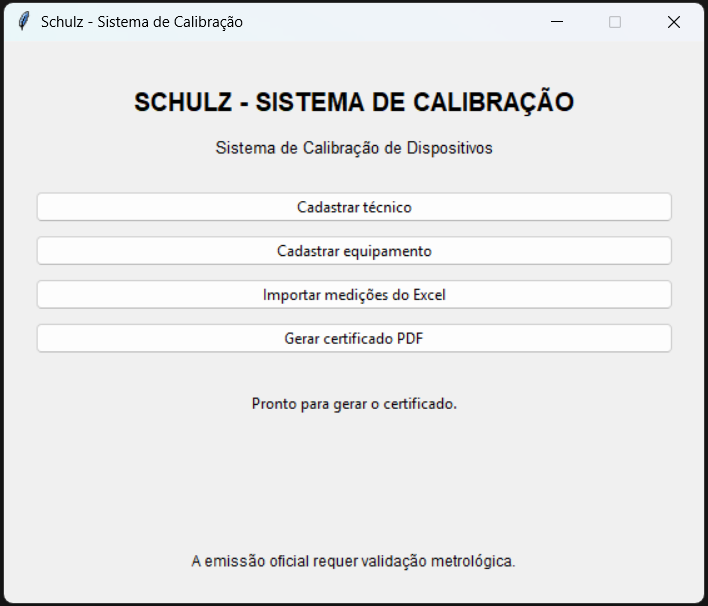
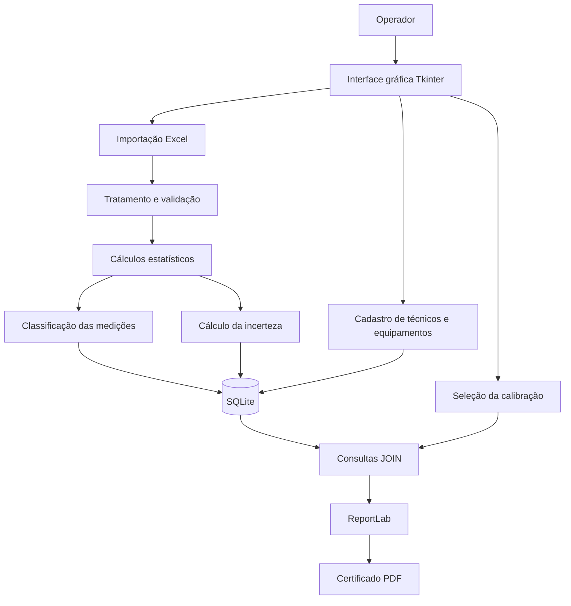
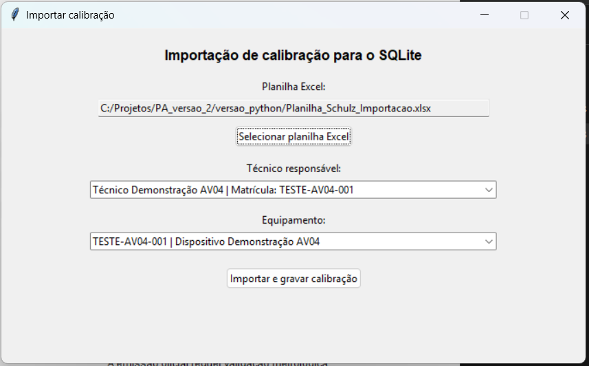
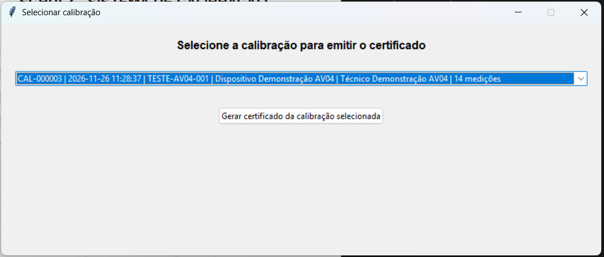
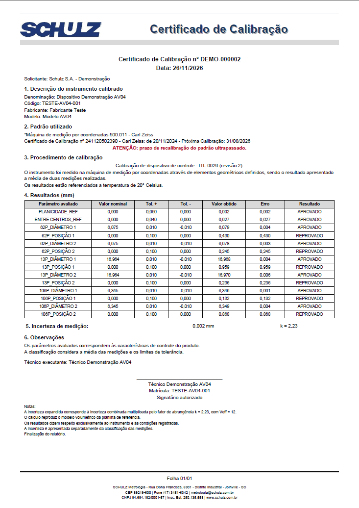

# Sistema de Calibração de Dispositivos — Schulz S.A.

## Projeto Aplicado I — AV01, AV02, AV03 e AV04

**Empresa parceira:** Schulz S.A.  
**Unidade Curricular:** Projeto Aplicado I  
**Ano:** 2026  
**Alunos:** Bruno Henridson Galvão, Lucas Jean Pacheco, Mateus Junior Consoli, Rodrigo Nunes, Sthefane Pita  
**Situação:** MVP desenvolvido e validado funcionalmente.

---

## 1. Sobre o projeto

O projeto consiste no desenvolvimento de uma aplicação destinada à automação do processamento de informações relacionadas à calibração de dispositivos da Schulz S.A.

A solução integra a importação de planilhas Excel, o tratamento das medições, os cálculos estatísticos, o cálculo da incerteza de medição, a classificação dos resultados, a persistência em banco de dados SQLite e a geração de certificados de calibração em PDF.

A versão final disponibiliza uma interface gráfica e um executável para Windows, permitindo a utilização do software sem necessidade de terminal ou ambiente de desenvolvimento.

## 2. Objetivos

- Automatizar o processamento das medições.
- Reduzir operações manuais e repetitivas.
- Centralizar as informações em um banco de dados relacional.
- Padronizar os cálculos implementados.
- Classificar os resultados conforme os limites de tolerância.
- Automatizar a geração de certificados de calibração.
- Facilitar a utilização do software pelo operador.

## 3. Evolução do projeto

| Avaliação | Etapa | Situação |
|---|---|---|
| AV01 | Levantamento de requisitos e regras de tratamento dos dados | Concluída |
| AV02 | Modelagem e implementação do banco de dados | Concluída |
| AV03 | Programação orientada a objetos e construção inicial do MVP | Concluída |
| AV04 | Integração final, interface gráfica, certificados e executável | Concluída |

## 4. Tecnologias utilizadas

| Tecnologia | Finalidade |
|---|---|
| Python 3.13.17 | Desenvolvimento da aplicação |
| SQLite | Persistência relacional |
| Tkinter | Interface gráfica |
| OpenPyXL 3.1.5 | Importação de planilhas Excel |
| ReportLab 5.1.0 | Geração de certificados PDF |
| PyInstaller 6.22.3 | Geração do executável Windows |
| Markdown | Documentação técnica |
| Git e GitHub | Versionamento do projeto |
| Visual Studio Code | Ambiente de desenvolvimento |

## 5. Funcionalidades

- Cadastro de técnicos.
- Cadastro de equipamentos.
- Importação de medições provenientes do Excel.
- Validação e tratamento dos dados importados.
- Cálculo da média aritmética.
- Cálculo do desvio padrão amostral.
- Classificação das medições.
- Cálculo da incerteza volumétrica.
- Determinação dos graus de liberdade efetivos.
- Determinação do fator de abrangência.
- Cálculo da incerteza expandida.
- Armazenamento das calibrações no SQLite.
- Recuperação de informações por consultas JOIN.
- Geração de certificados PDF com tabela dinâmica.

## 6. Interface gráfica

A interface foi desenvolvida utilizando Tkinter, disponibilizando as principais funcionalidades em uma única tela.



## 7. Arquitetura do software



## 8. Estrutura do projeto

```text
versao_python/
├── assets/
│   └── schulz_logo_original.jpg
├── classes/
│   ├── __init__.py
│   ├── banco_dados.py
│   ├── equipamento.py
│   ├── medicao.py
│   └── tecnico.py
├── servicos/
│   ├── __init__.py
│   ├── calculo_incerteza.py
│   ├── classificador_medicoes.py
│   ├── gerador_certificado.py
│   ├── importador_registro.py
│   ├── incerteza_certificado.py
│   ├── integracao_certificado_sqlite.py
│   └── motor_incerteza.py
├── docs/
│   └── imagens/
├── .gitignore
├── 01_estrutura.md
├── 02_dicionario.md
├── 03_banco.sql
├── 04_classes.py
├── 05_main.py
├── 06_migracao_banco_av04.py
├── 06_mvp_parte1.md
├── 07_gerador_certificado.py
├── 08_mvp_final_manual.md
├── 08_mvp_final_manual.pdf
├── executar_banco.py
├── Planilha_Schulz_Importacao.xlsx
├── requirements.txt
├── Schulz_Calibracao.spec
└── README.md
```

Por questões de confidencialidade, a planilha `Planilha_Schulz_Importacao.xlsx` não está disponível no repositório público. O arquivo integra exclusivamente o pacote de entrega acadêmica do projeto.

Os ambientes virtuais, bancos de dados locais, arquivos temporários e arquivos gerados durante a compilação são mantidos fora do versionamento.

## 9. Banco de dados

A aplicação utiliza quatro entidades principais:

| Entidade | Responsabilidade |
|---|---|
| tecnico | Cadastro dos técnicos |
| equipamento | Cadastro dos dispositivos |
| calibracao | Consolidação das calibrações |
| medicao | Registro dos parâmetros e resultados |

A persistência utiliza chaves primárias, chaves estrangeiras, consultas parametrizadas e transações.

A estrutura original do banco foi preservada e ampliada durante a AV04 por meio de um script de migração.

## 10. Instalação para desenvolvimento

### 10.1 Requisitos

- Sistema operacional Windows.
- Python 3.13.
- Código-fonte do projeto.

### 10.2 Criar o ambiente virtual

```powershell
python -m venv .venv
```

### 10.3 Ativar o ambiente virtual

```powershell
.\.venv\Scripts\Activate.ps1
```

### 10.4 Instalar as dependências

```powershell
python -m pip install -r requirements.txt
```

### 10.5 Preparar um novo banco de dados

Caso o banco de dados ainda não exista:

```powershell
python executar_banco.py
python 06_migracao_banco_av04.py
```

Não execute a criação de um novo banco sobre uma base existente sem realizar uma cópia de segurança.

### 10.6 Executar a aplicação

```powershell
python 07_gerador_certificado.py
```

## 11. Geração do executável

A compilação é realizada utilizando PyInstaller:

```powershell
python -m PyInstaller `
    --noconfirm `
    --clean `
    --onedir `
    --windowed `
    --name Schulz_Calibracao `
    --add-data "assets;assets" `
    07_gerador_certificado.py
```

Antes de recompilar, preserve qualquer banco existente na pasta de distribuição.

Após a compilação, disponibilize uma cópia do banco SQLite junto ao executável:

```powershell
Copy-Item .\schulz_calibracao.db .\dist\Schulz_Calibracao\
```

### Estrutura da distribuição

```text
Schulz_Calibracao/
├── _internal/
├── Schulz_Calibracao.exe
└── schulz_calibracao.db
```

A pasta de distribuição deve ser mantida integralmente.

O executável e suas dependências são disponibilizados separadamente no pacote de entrega do projeto.

## 12. Utilização do software

1. Abrir o arquivo Schulz_Calibracao.exe.
2. Cadastrar o técnico responsável.
3. Cadastrar o equipamento.
4. Selecionar a opção Importar medições do Excel.
5. Selecionar a planilha de calibração.
6. Vincular o técnico e o equipamento.
7. Confirmar o processamento e a gravação.
8. Selecionar a opção Gerar certificado PDF.
9. Selecionar a calibração desejada.
10. Salvar o certificado.

Não é necessário instalar o Python ou utilizar terminal para operar a versão empacotada.

### Importação das medições



### Seleção da calibração



## 13. Resultados da validação

### 13.1 Classificação das medições

| Indicador | Resultado |
|---|---:|
| Medições processadas | 14 |
| Medições aprovadas | 8 |
| Medições reprovadas | 6 |
| Percentual de aprovação | 57,14% |
| Percentual de reprovação | 42,86% |

### 13.2 Cálculo da incerteza volumétrica

| Indicador | Resultado |
|---|---:|
| Componentes de incerteza | 8 |
| Incerteza combinada | 0,931344277 µm |
| Graus de liberdade efetivos utilizados | 12 |
| Fator de abrangência | 2,23 |
| Incerteza expandida | 2,076897738 µm |
| Incerteza expandida em milímetros | 0,002076898 mm |
| Incerteza apresentada no certificado | 0,002 mm |

Os resultados reproduziram o modelo volumétrico utilizado como referência durante o desenvolvimento.

### 13.3 Testes funcionais

Foram validadas as funcionalidades de cadastro, importação, cálculos, classificação, persistência, recuperação relacional e geração de certificados.

Também foram realizados testes de funcionamento do executável Windows.

Os 17 testes funcionais estão documentados no manual final da AV04, incluindo a conferência de abertura da compilação definitiva.

### 13.4 Integridade do banco de dados

```text
Integridade: ok
Erros de vinculo: []
```

Os registros fictícios foram removidos dos bancos ativos após a preservação das evidências acadêmicas.

## 14. Certificado de calibração

O certificado é gerado dinamicamente a partir dos registros armazenados no SQLite.

A estrutura contempla os dados de identificação, padrões utilizados, procedimento, resultados das medições, incerteza e observações complementares.



As imagens que apresentam registros fictícios correspondem às evidências acadêmicas utilizadas durante a validação do MVP.

## 15. Documentação

| Documento | Descrição |
|---|---|
| [01_estrutura.md](01_estrutura.md) | Estrutura do projeto |
| [02_dicionario.md](02_dicionario.md) | Dicionário de dados |
| [03_banco.sql](03_banco.sql) | Estrutura original do banco |
| [04_classes.py](04_classes.py) | Classes desenvolvidas |
| [05_main.py](05_main.py) | Implementação inicial do MVP |
| [06_mvp_parte1.md](06_mvp_parte1.md) | Documentação da construção inicial |
| [07_gerador_certificado.py](07_gerador_certificado.py) | Aplicação integrada |
| [08_mvp_final_manual.md](08_mvp_final_manual.md) | Documentação técnica e manual ilustrado |
| [08_mvp_final_manual.pdf](08_mvp_final_manual.pdf) | Documentação consolidada em PDF |

## 16. Limitações

- Implementação do modelo volumétrico de incerteza.
- Dependência dos valores previamente calculados na planilha Excel.
- Necessidade de confirmação metrológica das conversões de unidades.
- Necessidade de validação complementar das regras de saneamento.
- Numeração interna dos certificados ainda não homologada.
- Ausência de assinatura digital.
- Portabilidade em outros computadores Windows ainda não verificada.
- Ausência de homologação metrológica formal pela empresa parceira.

## 17. Conclusão

O projeto consolidou os conhecimentos desenvolvidos durante as quatro avaliações da Unidade Curricular Projeto Aplicado I.

A solução integra programação orientada a objetos, banco de dados relacional, processamento de planilhas, cálculos estatísticos, interface gráfica e geração automatizada de documentos.

A versão final do MVP demonstrou a viabilidade técnica da automação do fluxo de processamento das calibrações, constituindo uma base para futuras evoluções e validações junto à Schulz S.A.

---

**Projeto Aplicado I — 2026**